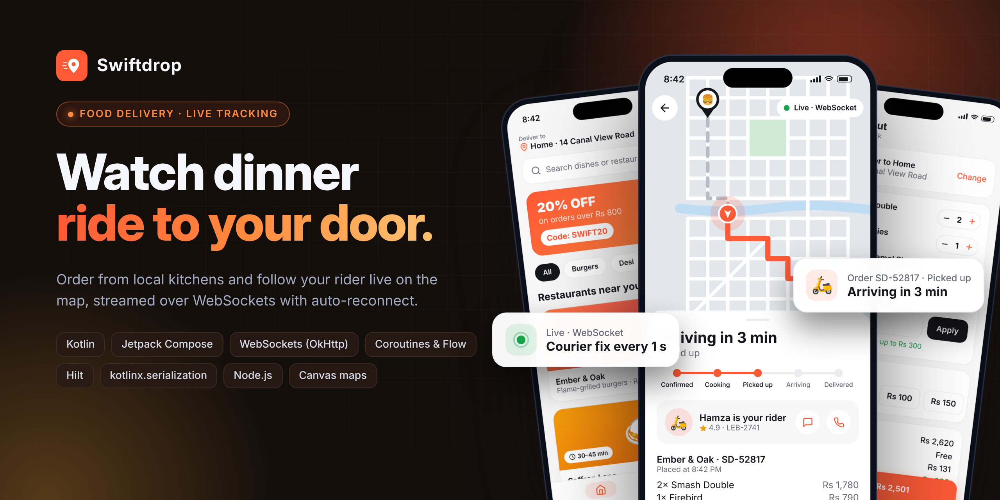
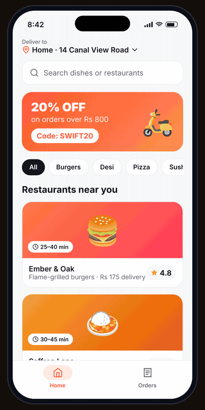
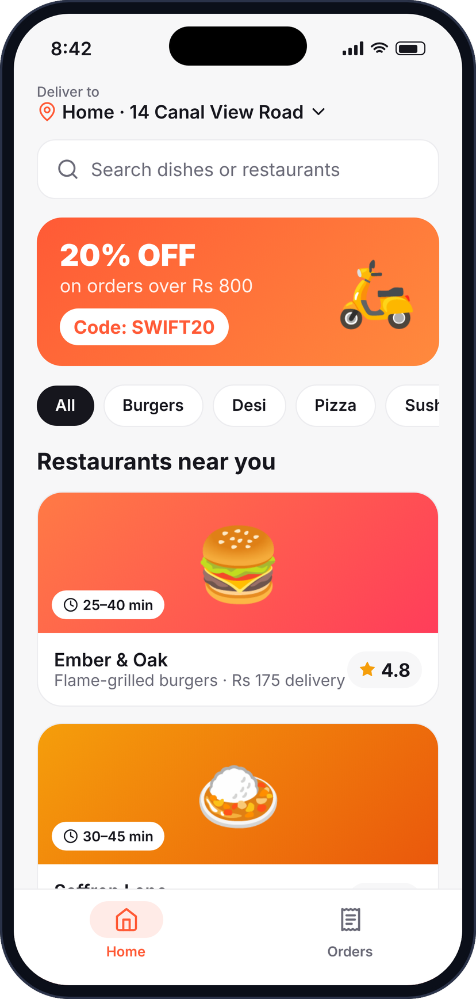
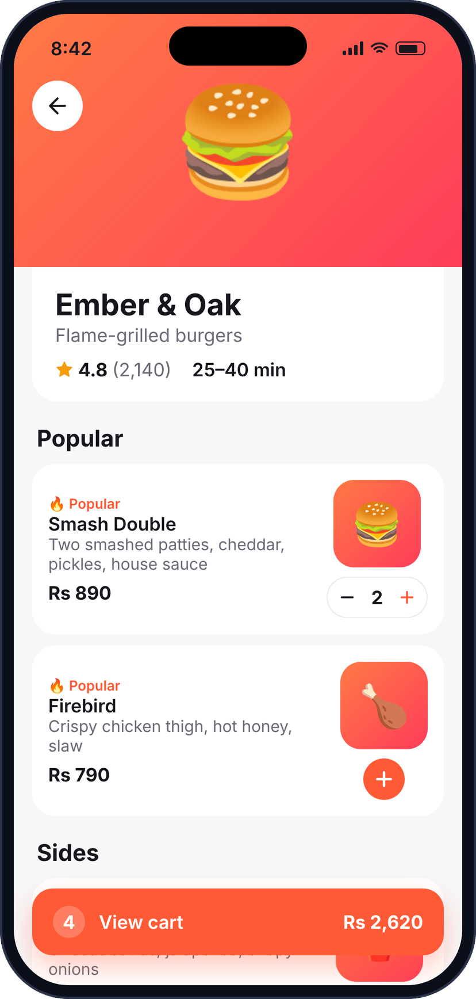
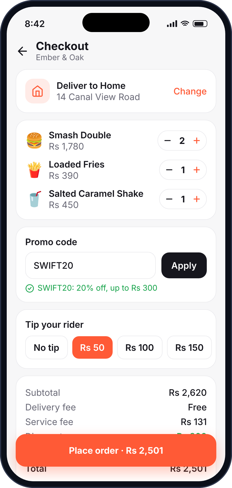
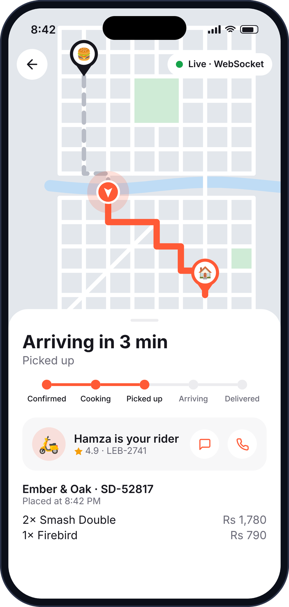

<p align="center">
  
</p>

<h1 align="center">Swiftdrop: Food Delivery with Live Tracking</h1>

<p align="center">
  
  
  
  
  
</p>

<p align="center">
  <a href="https://github.com/asadfareed777/swiftdrop-delivery/releases/latest">
    
  </a>
  &nbsp;
  <a href="https://github.com/asadfareed777/swiftdrop-delivery/actions/workflows/android.yml">
    
  </a>
</p>

Swiftdrop is a food-delivery app: browse restaurants, build a cart, check out, then follow your rider live on a map as the order moves from the kitchen to your door. Live updates arrive over a real WebSocket from the included Node.js server, and an offline simulator speaks the same protocol so the app also demos without a backend.

## Demo

<p align="center"></p>

## Screens

| Restaurants | Menu & cart | Checkout | Live tracking |
|:---:|:---:|:---:|:---:|
|  |  |  |  |

## Features

- **Live tracking:** status, courier position and ETA stream over an OkHttp WebSocket with keep-alive pings. Reconnects use exponential backoff with jitter (1 s → 30 s), and the UI shows the connection state (Live, Reconnecting in 4 s, Completed).
- **Out-of-order messages handled:** a pure reducer only moves statuses forward, drops stale GPS fixes and freezes after delivery, so reconnects and replays never make the UI go backwards.
- **Custom map:** the city, river, parks, route and rider are drawn with Compose `Canvas`. The camera frames the whole journey, the rider marker glides between fixes and turns with the street, and the part of the route already travelled is greyed out. No Maps SDK or API key is needed.
- **Routing and ETA:** A* shortest path over the street graph (river bridges, a park and a diagonal boulevard). The ETA combines remaining prep time and riding time.
- **Cart and checkout:** one restaurant per cart, a delivery fee by distance with free delivery over Rs 2,500, a capped service fee, a small-order fee, the promo codes `SWIFT20` and `FREEDEL`, and rider tips.
- **Two transports, one interface:** `TrackingSocket` is implemented by both the OkHttp client and an in-app simulator. You switch between them in Orders → Live tracking server.

## Architecture

```
swiftdrop/
├── delivery-core/            # pure Kotlin, no Android
│   ├── City.kt               # street graph, A*, Route (interpolation, bearing, remaining distance)
│   ├── Tracking.kt           # OrderStatus, TrackingEvent, TrackingState reducer, Eta, Backoff
│   ├── Pricing.kt            # fees, service charge, promos, tips
│   └── CourierSimulator.kt   # deterministic event script for one order
├── app/
│   ├── data/tracking/        # TrackingSocket: OkHttp WebSocket + Simulated, JSON protocol
│   ├── data/OrderRepository  # cart, orders, reconnecting tracking flow (channelFlow + stateIn)
│   └── ui/                   # Compose screens, CityMapCanvas, ViewModels (Hilt)
└── server/                   # Node.js `ws` tracking server + end-to-end test
```

**Wire protocol** (shared by the server and `TrackingProtocol.kt`):

```json
{ "type": "status",   "status": "PICKED_UP", "at": 1764170000000 }
{ "type": "location", "x": 450.0, "y": 300.0, "bearing": 90.0, "at": 1764170001000 }
{ "type": "eta",      "seconds": 240, "at": 1764170001000 }
```

The street graph in `server/city.json` is exported from `delivery-core`, so the client and server route on the same map. A test checks both give the same 1,050 m river-bridge detour.

## Run it

```bash
# 1) App (offline simulator mode works out of the box)
./gradlew installDebug

# 2) Optional: real WebSocket server
cd server
npm install
npm start            # ws://localhost:8080
```

In the app, go to **Orders → Live tracking server**, switch it on and keep `ws://10.0.2.2:8080` (the emulator's alias for your computer). Cleartext `ws://` is allowed only for `10.0.2.2` and `localhost` through `network_security_config.xml`. Production should use `wss://`.

## Tests

```bash
./gradlew :delivery-core:test :app:testDebugUnitTest
cd server && npm test
```

- **delivery-core (22 tests):** routing (connectivity, bridges, park, diagonal), interpolation and bearings; the tracking reducer (monotonic statuses, stale fixes, cancel rules, terminal freeze); ETA labels; backoff growth, cap and seeded jitter; pricing (distance fees, free delivery, service cap, small-order fee, promo validation); the simulator (lifecycle order, timestamps, replay ends at the door, ETA counts down).
- **app:** decoding of every message type, unknown-field tolerance, and malformed messages being dropped.
- **server:** starts the server, places an order, checks the complete status sequence and live location stream, and checks that bad URLs are rejected with close code 4400.

CI runs all three suites and builds the APK on every push.

## Roadmap

- Server-side order state, so reconnects resume instead of replaying
- Google Maps / MapLibre layer behind the same `CityMapCanvas` API
- Push notifications for status changes (FCM)
- Rider app sharing `delivery-core`

## License

MIT. See [LICENSE](LICENSE). All restaurant names, menus and the city map are fictional.

---

<p align="center">Built by <a href="https://github.com/asadfareed777"><b>Asad Fareed</b></a>, Senior Android & Flutter Engineer</p>
